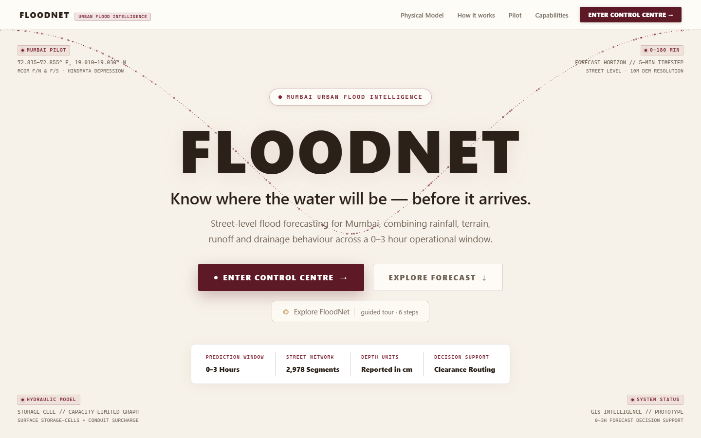
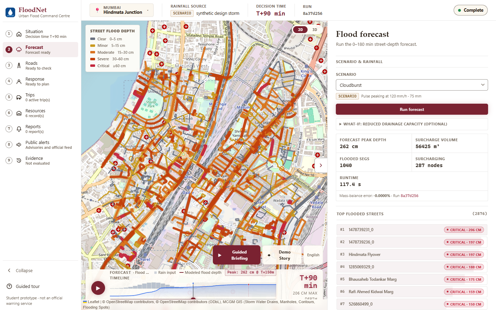
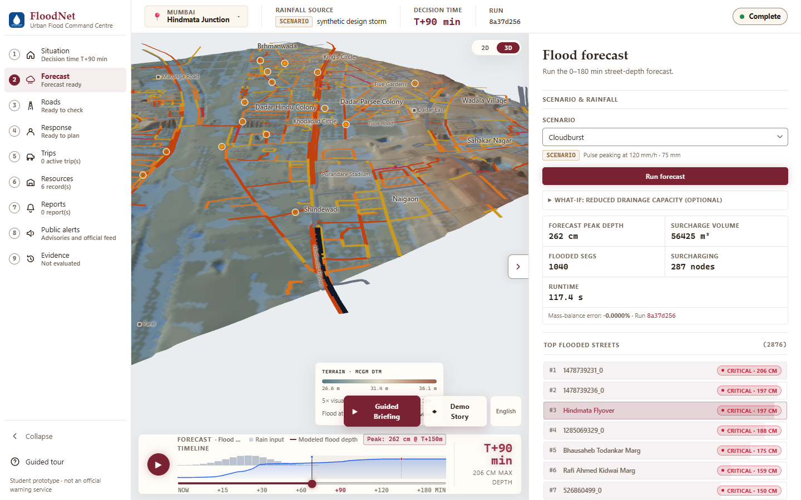
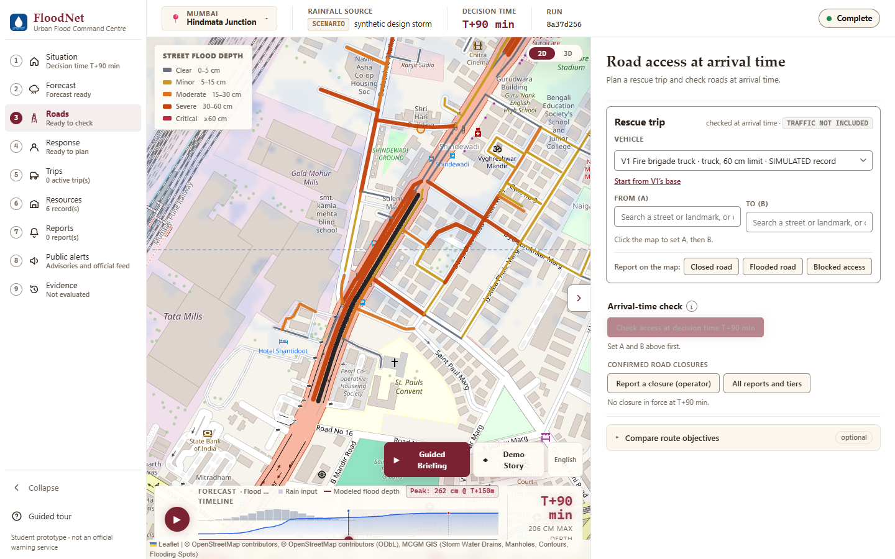
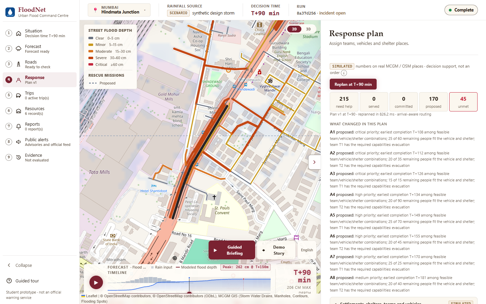

# FloodNet — Urban Flood Nowcasting for Mumbai

**Know where the water will be, before it arrives.**

FloodNet forecasts street-level flood depth for the next 0–3 hours and turns it into decisions. It shows
which roads will be passable when a rescue vehicle gets there, and which teams, vehicles and shelters to send
where. The pilot covers the Hindmata / Dadar–Parel–Matunga area of Mumbai, one of the city's most
flood-prone low points, on a 10 m grid.



> **Prototype.** FloodNet is decision support for a pilot area. It is not an official warning service.
> Physics is deliberately simplified, and several parameters are estimated. See [Limitations](#limitations).

---

## Contents

- [What it does](#what-it-does)
- [Screenshots](#screenshots)
- [How it works](#how-it-works)
- [Data](#data)
- [Tech stack](#tech-stack)
- [Getting started](#getting-started)
- [Project structure](#project-structure)
- [Testing](#testing)
- [Limitations](#limitations)
- [Documentation](#documentation)

---

## What it does

| Area | What the operator gets |
|---|---|
| **Flood forecast** | Street-by-street flood depth every 5 minutes for 0–180 minutes, peak depth, onset time, flooded road length and ranked hotspots. |
| **Why it floods** | For any street, the surface water and the state of the drains beneath it: surcharging manholes, pipe utilisation and blockage. |
| **3D terrain** | The model's own terrain mesh, built from municipal contour data, with forecast water draped on it. |
| **Road access at arrival time** | Each road is checked at the minute a vehicle is expected to reach it, not only at the current time. Confirmed closures are enforced. |
| **Flood-aware routing** | Direct route compared with a lower flood-risk route, plus multiple route objectives, over the real street network. |
| **Response planner** | Assigns teams, vehicles and shelter places to the settlements that need help. It explains unmet needs and replans after closures or vehicle loss. |
| **Live operations** | Rescue trips, field reports, a resource registry, a shared incident clock and role-based access. |
| **Alerts** | Drafts in the CAP 1.2 alert format for review by an authorised authority, plus test SMS, WhatsApp and Telegram messages to the team. |
| **Guided briefing** | A spoken walkthrough of the current forecast in English, Hindi and Marathi. |
| **Replay and evaluation** | Replays a scripted emergency and scores the plan against an independent outcome run. |

---

## Screenshots

**Flood forecast at T+90 minutes in a cloudburst scenario.** Streets are coloured by forecast depth, and
the right panel ranks the worst-hit streets.



**3D terrain.** The forecast water is draped over the terrain model the solver actually uses.



**Road access at arrival time.** Rescue trips are planned against the depth each road will have when the
vehicle reaches it.



**Response plan.** Teams, vehicles and shelters are assigned by priority, and every assignment gives its
reason. The resource numbers are simulated, placed on real locations.



---

## How it works

```
 Rainfall ──► Runoff ──► 2D surface flow ⇄ Drainage network ──► Flood depth ──► Decisions
 (design      (impervious   (storage-cell     (MCGM pipes and       (per street,    (hotspots, road access,
  storm,       surfaces,     routing on a      manholes: capacity,   every 5 min,    routing, response plan,
  replay,      abstraction)  10 m terrain      surcharge, blockage)  0–180 min)      alert drafts)
  forecast,                  grid)
  radar)
```

1. **Rainfall.** A rainfall provider turns the selected source into a rainfall field over time.
2. **Runoff.** Rain on impervious surfaces such as roads and roofs becomes runoff, after initial losses.
3. **Surface flow.** Water moves across a 10 m terrain grid between storage cells, following the ground.
4. **Drainage.** Inlets pass water into the real stormwater network. Each pipe is limited by its Manning
   capacity, and manholes surcharge back to the surface when the network is full.
5. **Depth.** Water on each street segment is reported as depth in centimetres, with mass balance checked
   on every run.
6. **Decisions.** Depth drives hotspots, arrival-time road access, routing, the response plan and alert drafts.

---

## Data

| Component | Status | Source |
|---|---|---|
| Drainage network: geometry, connectivity, sizes, inverts, ground levels | Real | MCGM (Municipal Corporation of Greater Mumbai) ArcGIS REST layers, snapshot 2026-09-08 |
| Terrain | Real, interpolated | MCGM 20 cm contours and manhole ground levels |
| Roads and buildings | Real | © OpenStreetMap contributors, ODbL |
| Known flooding spots | Real | MCGM Flooding Spots layer |
| Pipe roughness, inlet capacity, manhole storage, impervious fractions | Estimated | Stated rules and cited ranges, documented in each module |
| Rainfall: design storms | Synthetic | Moderate, heavy and cloudburst scenarios |
| Rainfall: historical replay | Real | 26 July 2005 Santacruz gauge record, from the Chitale Committee report |
| Rainfall: forecast | Forecast | ECMWF IFS HRES model via Open-Meteo |
| Rainfall: radar-derived | Experimental estimate | Decoded from the IMD Mumbai–Veravali weather radar image |
| Drain blockage | Synthetic what-if | A scenario input, never an observed condition |
| Response resources | Simulated | Simulated numbers placed on real locations |

Every run carries its own provenance, and the app's Sources tab shows it in full. Detailed provenance lives in
[data/raw/mcgm_gis/PROVENANCE.md](data/raw/mcgm_gis/PROVENANCE.md) and
[data/processed/pilot/PROVENANCE.md](data/processed/pilot/PROVENANCE.md).

---

## Tech stack

| Layer | Technology |
|---|---|
| Backend API | Python, FastAPI, Pydantic, Uvicorn |
| Simulation | NumPy, SciPy |
| Geospatial and routing | Shapely, pyproj, NetworkX |
| Frontend | React 19, Vite, Leaflet, three.js |
| Optional | Pillow for radar images, cryptography for encrypted subscriber numbers, pyswmm for offline validation |
| Deployment | Docker for the API, or Vercel for both frontend and API |

---

## Getting started

### Prerequisites

- Python 3.11 or newer
- Node.js 20.19 or newer, or 22.12 or newer
- [uv](https://docs.astral.sh/uv/) is recommended, but plain `pip` works

### 1. Backend

```powershell
cd backend
uv venv .venv
uv pip install --python .venv\Scripts\python.exe -e ".[dev,radar,ops]"
```

On macOS or Linux, use `.venv/bin/python` instead of `.venv\Scripts\python.exe`.

The processed pilot data is already in `data/processed/pilot`. To rebuild it from the raw sources, which needs
internet access:

```powershell
.venv\Scripts\python.exe -m floodnet.data.build_pilot
```

### 2. Frontend

Build the frontend **before** starting the backend. The backend decides at start-up whether to serve the build.

```powershell
cd frontend-react
npm install
npm run build
```

### 3. Run

```powershell
cd backend
.venv\Scripts\python.exe -m uvicorn floodnet.api.main:app --port 8000
```

Open <http://localhost:8000> and choose **Enter Control Centre**. On the **Forecast** page, pick a scenario
such as *Cloudburst* and press **Run forecast**. A full three-hour run takes about one to two minutes. Then drag
the timeline to watch the water spread.

Interactive API documentation is served at <http://localhost:8000/docs>.

### Frontend development server

For hot reload while editing the UI, run this alongside the backend. It proxies `/api` to port 8000.

```powershell
cd frontend-react
npm run dev
```

### Configuration

Optional integrations are configured with environment variables in a `.env` file at the repository root. These
cover messaging providers, text-to-speech and live traffic. Environment files are not committed. The app runs
without them, and the affected features say they are unavailable instead of failing.

### Docker

The Docker image runs the backend API only. Serve the frontend build separately, for example from a static
host, and point it at the API.

```bash
docker build -t floodnet-api .
docker run -p 8000:8000 floodnet-api
```

Deployment details, including the single-project Vercel setup, are in [docs/DEPLOYMENT.md](docs/DEPLOYMENT.md).

---

## Project structure

```
.
├── backend/
│   ├── floodnet/
│   │   ├── api/          FastAPI app and routes
│   │   ├── rainfall/     rainfall providers: scenarios, replay, forecast, radar
│   │   ├── terrain/      runoff, 2D storage-cell surface model, terrain
│   │   ├── drainage/     drainage graph hydraulics and blockage scenarios
│   │   ├── simulation/   the coupled surface and drainage engine
│   │   ├── streets/      flood depth per street segment
│   │   ├── routing/      flood-aware routing
│   │   ├── access/       arrival-time road access and road events
│   │   ├── response/     response and resource planner
│   │   ├── ops/          live operations: trips, registry, roles, incident clock
│   │   ├── alerts/       CAP 1.2 alert drafts and team test alerts
│   │   ├── messaging/    subscriber advisories and the public alert page
│   │   ├── traffic/      live traffic for trip time estimates
│   │   ├── analysis/     hotspots and derived analyses
│   │   ├── validation/   offline cross-checks, including SWMM
│   │   └── data/         pilot data build pipeline
│   ├── scripts/          diagnostics and evaluation scripts
│   └── tests/            pytest suite
├── frontend-react/       React + Vite dashboard
├── data/
│   ├── raw/              MCGM GIS and OpenStreetMap snapshots
│   └── processed/pilot/  model-ready terrain, network, roads, hotspots
├── docs/                 design, decisions, validation and audit documents
├── research/             background research
├── app.py                Vercel entrypoint
├── Dockerfile
└── vercel.json
```

---

## Testing

```powershell
# backend
cd backend
.venv\Scripts\python.exe -m pytest tests -q

# frontend unit tests
cd frontend-react
npm run test:unit
```

Tests that call real external services are opt-in and skipped by default.

---

## Limitations

- **Simplified physics.** Surface flow uses storage-cell routing, and the drainage network uses
  capacity-based graph hydraulics. Neither solves the full shallow-water or Saint-Venant equations.
- **Terrain precision.** The terrain comes from 20 cm contours, so vertical precision is roughly 0.2 m.
- **Estimated parameters.** Pipe roughness, inlet capacity, manhole storage and impervious fractions are
  estimated, not measured.
- **No accuracy claim.** The model has not been calibrated against observed flood depths, and no accuracy
  figure is claimed. What is and is not validated is set out in [docs/VALIDATION.md](docs/VALIDATION.md).
- **Not a warning service.** Alert outputs are drafts for an authorised authority to review. Official flood
  warnings in India come from the designated government agencies.

---

## Documentation

| Document | Contents |
|---|---|
| [docs/ARCHITECTURE.md](docs/ARCHITECTURE.md) | System architecture |
| [docs/TECHNOLOGY_EXPLAINER.md](docs/TECHNOLOGY_EXPLAINER.md) | How the technology works, stage by stage |
| [docs/VALIDATION.md](docs/VALIDATION.md) | What is and is not validated |
| [docs/ROAD_ACCESS.md](docs/ROAD_ACCESS.md) | Arrival-time road access |
| [docs/RESPONSE_PLANNER.md](docs/RESPONSE_PLANNER.md) | Response planner |
| [docs/LIVE_OPERATIONS.md](docs/LIVE_OPERATIONS.md) | Live operations design |
| [docs/TERRAIN_3D.md](docs/TERRAIN_3D.md) | 3D terrain view |
| [docs/DEPLOYMENT.md](docs/DEPLOYMENT.md) | Deployment |
| [docs/DECISIONS.md](docs/DECISIONS.md) | Decision log |

---

Map data © OpenStreetMap contributors, ODbL. Drainage, contour and flooding-spot data from MCGM GIS.
